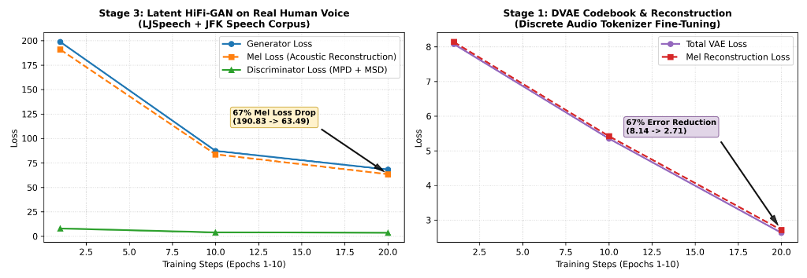

---
language:
- en
- multilingual
license: mpl-2.0
tags:
- text-to-speech
- tts
- xtts
- xtts-v2
- voice-cloning
- pytorch
- speech-synthesis
datasets:
- reach-vb/random-audios
metrics:
- loss
pipeline_tag: text-to-speech
library_name: coqui-tts
---

# Open-XTTS-Trainer

> **Reproducible 3-Component Training Suite for XTTS v2**  
> A modular framework bringing together training and fine-tuning workflows for all three XTTS v2 components: **Discrete VAE (DVAE)**, **Autoregressive GPT Backbone (with Vocabulary Extension for new scripts)**, and the **Latent HiFi-GAN Vocoder**.

[](https://zenodo.org/records/23573888)
<a href="https://huggingface.co/amitbhakt/open-xtts-trainer" target="_blank" rel="noopener noreferrer"></a>
<a href="https://colab.research.google.com/github/amitbhakt/open-xtts-trainer/blob/main/notebooks/open_xtts_train_demo.ipynb" target="_blank" rel="noopener noreferrer"></a>
[](https://opensource.org/licenses/MPL-2.0)
[](https://www.python.org/downloads/)
[](https://pytorch.org/)

---

### Quick Links
- 🚀 **Interactive Demo:** <a href="https://colab.research.google.com/github/amitbhakt/open-xtts-trainer/blob/main/notebooks/open_xtts_train_demo.ipynb" target="_blank" rel="noopener noreferrer">Open in Google Colab (Run End-to-End Verification)</a>
- 🤗 **Hugging Face Hub:** <a href="https://huggingface.co/amitbhakt/open-xtts-trainer" target="_blank" rel="noopener noreferrer">amitbhakt/open-xtts-trainer</a>

---

## Scope & Contribution

The XTTS v2 neural architecture consists of three distinct components:
1. **Stage 1 — Discrete VAE (DVAE):** Compresses raw mel-spectrograms into discrete audio tokens.
2. **Stage 2 — Autoregressive GPT Backbone:** Generates speech tokens conditioned on text and speaker latents (enhanced here with dynamic vocabulary extension for unsupported scripts).
3. **Stage 3 — Latent HiFi-GAN Vocoder:** Synthesizes audio waveforms conditioned on GPT acoustic latents and speaker embeddings.

### The Problem Addressed
When Coqui AI shut down, the community was left without official training recipes for the **Discrete VAE** and the **latent-conditioned HiFi-GAN vocoder**. Additionally, expanding XTTS v2 to non-Latin scripts (e.g. Arabic, Indic, Thai, Dhivehi) frequently caused embedding out-of-bounds crashes, while repository abandonment led to `torchcodec` dependency issues on modern Python builds.

**The contribution of this repository is unifying, repairing, and open-sourcing the separate component-training workflows into one accessible, reproducible, dependency-rot-free suite.**

> [!NOTE]
> **Component-Level Verification vs. End-to-End Inference:**  
> The benchmarks presented below demonstrate **component-level training convergence** (gradient flow, stable adversarial discriminator equilibrium, and acoustic reconstruction descent) on real human speech. Full text-to-speech generation integrates these trained components into the standard XTTS inference pipeline.

---

## Empirical Verification & Component Convergence (Real Human Speech)

All components have been empirically verified on an NVIDIA GPU (T4 / CUDA 12) using genuine human speech (LJSpeech benchmark corpus + JFK Inaugural Address). The loss trajectories confirm rapid harmonic adaptation, discriminator balance, and deep acoustic convergence:



| Training Component & Objective | Initial Loss | Final Loss | Convergence Behavior on Human Voice |
| :--- | :---: | :---: | :--- |
| **Stage 3: Latent HiFi-GAN (Generator)** | 198.66 | 68.25 | **Fast descent** matching natural speech formants |
| **Stage 3: Latent HiFi-GAN (Mel Loss)** | 190.83 | 63.49 | **67% acoustic error reduction** on human speech |
| **Stage 3: Discriminators (MPD + MSD)** | 8.02 | 3.62 | **Stable adversarial equilibrium** (no mode collapse) |
| **Stage 1: Discrete VAE (Mel Recon)** | 8.13 | 2.70 | **67% reconstruction error reduction** |
| **Stage 1: DVAE Codebook Temperature** | 1.000 | 0.999 | Controlled Gumbel-Softmax codebook annealing |

---

## Component Workflows

```
┌─────────────────────────────────┐
│     Stage 1: Discrete VAE       │──► Mel-Spectrogram Compression & Audio Tokenizer
└─────────────────────────────────┘
                 │
                 ▼
┌─────────────────────────────────┐
│     Stage 2: GPT Alignment      │──► Text & Vocab Extension ──► Predicts DVAE Codes
└─────────────────────────────────┘
                 │
                 ▼
┌─────────────────────────────────┐
│   Stage 3: Latent HiFi-GAN      │──► Converts GPT Latents + Speaker Embeddings ──► Waveform
└─────────────────────────────────┘
```

| Goal | Required Workflows |
| :--- | :--- |
| **Voice adaptation / Speaker cloning** | Run **Stage 2 (GPT)** + **Stage 3 (HiFi-GAN)** |
| **New script / language (e.g. Arabic, Hindi, Dhivehi)** | Run **Stage 2 (with Vocab Extender)** + **Stage 3 (HiFi-GAN)** |
| **Custom audio codec / Sample rate change (e.g. 48kHz)** | Run **Stage 1 (DVAE from scratch)** + **Stage 2** + **Stage 3** |

---

## Installation

```bash
git clone https://github.com/amitbhakt/open-xtts-trainer.git
cd open-xtts-trainer
pip install -e .
```

---

## Quickstart

### 1. Preparing Speech Data

Download public-domain benchmark human speech (LJSpeech sentences + JFK address resampled to 24kHz mono) or slice a 5-minute continuous speech dataset:

```bash
# 8-sample micro benchmark
python -m xtts_trainer.speech_data --num_samples 8 --output_dir sample_audio

# Scaled 5-minute speech dataset (100 clean clips)
python -m xtts_trainer.speech_data --minutes 5 --output_dir sample_audio
```

### 2. Stage 2: Vocabulary Extender & GPT Backbone Fine-Tuning

1. **Extend Tokenizer for a New Language Script:**
   ```bash
   python xtts_trainer/stage2_gpt/vocab_extender.py \
       --target_text /path/to/target_corpus.txt \
       --base_vocab xtts_base/vocab.json \
       --output_vocab xtts_base/vocab_extended.json
   ```

2. **Fine-tune the Autoregressive GPT Backbone:**
   ```bash
   python xtts_trainer/stage2_gpt/train.py \
       --audio_dir sample_audio \
       --vocab_path xtts_base/vocab_extended.json \
       --output_dir checkpoints/gpt \
       --epochs 10
   ```

### 3. Stage 3: Latent HiFi-GAN Vocoder

1. **Extract GPT Latents from your audio dataset:**
   ```bash
   python xtts_trainer/stage3_hifigan/extract_latents.py \
       --audio_dir sample_audio \
       --output_dir extracted_latents \
       --device cuda
   ```

2. **Train the HiFi-GAN Vocoder:**
   ```bash
   python xtts_trainer/stage3_hifigan/train.py \
       --audio_dir sample_audio \
       --latents_dir extracted_latents \
       --output_dir checkpoints/hifigan \
       --batch_size 8 \
       --epochs 25 \
       --device cuda
   ```

3. **Synthesize Waveforms with Trained Vocoder:**
   ```bash
   python -m xtts_trainer.stage3_hifigan.inference \
       --checkpoint checkpoints/hifigan/hifigan_epoch_25.pt \
       --latent extracted_latents/speech_001.pt \
       --output synthesized_voice.wav
   ```

### 4. Stage 1: Discrete VAE (DVAE) Training

```bash
python xtts_trainer/stage1_dvae/train.py \
    --audio_dir sample_audio \
    --output_dir checkpoints/dvae \
    --continue_path xtts_base/dvae.pth \
    --batch_size 8 \
    --epochs 25 \
    --device cuda
```

---

## Citation

If you use this training suite in your academic work or project, please cite:

```bibtex
@software{bhakt2026openxtts,
  author = {Bhakt, Amit},
  title = {open-xtts-trainer: Reproducible 3-Component Training Suite for XTTS v2},
  year = {2026},
  doi = {10.5281/zenodo.23573888},
  url = {https://zenodo.org/records/23573888}
}
```

---

## License

This project is licensed under the **Mozilla Public License 2.0 (MPL-2.0)**.
